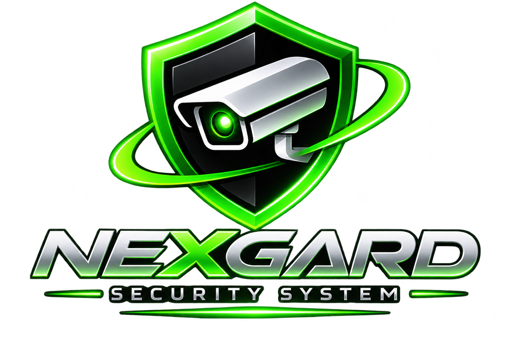

<div align="center">
  
  <h1>NexGard Security System</h1>
  <p><strong>Local-first IP camera dashboard, video streaming, camera audio controls, and on-device object detection.</strong></p>
  <p>
    
    
    
    
  </p>
</div>

NexGard is a self-hosted security-camera dashboard. It has its own FastAPI backend, SQLite database, and browser interface. It connects to compatible IP cameras over the local network, uses FFmpeg to convert RTSP video to browser-playable MJPEG, and can run a small YOLO object-detection model locally with ONNX Runtime.

> **Project status:** NexGard 0.6.5 is an actively developed personal project. Hardware support varies by camera model and firmware. Review the limitations and security notes below before using it beyond a trusted home/lab network.

## Contents

- [Features](#features)
- [Current limitations](#current-limitations)
- [Architecture](#architecture)
- [Requirements](#requirements)
- [Quick install](#quick-install)
- [Run as a system service](#run-as-a-system-service)
- [Local HTTPS with Nginx](#local-https-with-nginx)
- [Add a Reolink camera](#add-a-reolink-camera)
- [Install and enable local AI](#install-and-enable-local-ai)
- [Optional local text correction](#optional-local-text-correction)
- [Configuration](#configuration)
- [Data and backups](#data-and-backups)
- [Troubleshooting](#troubleshooting)
- [Security and privacy notes](#security-and-privacy-notes)
- [Third-party components](#third-party-components)
- [License](#license)

## Features

### Dashboard and device management

- Password-protected administrator dashboard.
- Change the administrator password from **Security settings**.
- Add and remove IP cameras; configure RTSP host, port, stream path, credentials, vendor, control port, and room.
- ONVIF discovery on the local network (subject to network multicast and camera support).
- Create rooms and assign cameras to them.
- Register SMB/NFS storage targets in the dashboard.

### Live camera view

- Live RTSP video is pulled by the server and converted by FFmpeg to an MJPEG stream for browsers.
- Reolink stream-path detection and main/substream fallback.
- Adjustable camera grid from one to four columns.
- Fullscreen for an individual camera.
- Fullscreen for the entire camera grid.
- Escape exits browser fullscreen.

### Camera audio controls

For compatible Reolink models, the optional Reolink CLI integration provides:

- Camera capability checks.
- Microphone listening when an audio track is present in the RTSP stream and FFmpeg can decode it.
- Browser microphone talkback to the camera speaker.
- Text-to-speech announcements using `espeak-ng` and FFmpeg.
- Manual one-shot siren playback and stop controls when the camera firmware supports them.
- Optional local text correction through an Ollama instance listening on localhost.

Audio capabilities are model- and firmware-dependent. A camera can support two-way talk in the Reolink app but expose different capabilities to third-party LAN integrations. NexGard checks reported capabilities rather than assuming every camera supports every command.

### Local AI and event history

- YOLOv8n COCO ONNX object detection using ONNX Runtime's CPU provider.
- Local detection categories currently include people, bicycles, cars, motorcycles, buses, trucks, birds, cats, dogs, horses, sheep, and cows.
- Enabled camera workers sample a low-bandwidth stream approximately once every four seconds.
- CPU inference is serialized to reduce load on modest servers.
- Temporary per-camera person-track IDs for a continuous tracking session.
- Event history and rate-limited person snapshots in the People Library.
- AI Center status, provider, model availability, worker information, and error reporting.
- AI can be enabled or disabled per camera.

Person-track IDs are temporary event/tracker IDs. They are **not** facial identities.

## Current limitations

The following are not implemented in version 0.6.5 and should not be assumed to work:

- Facial recognition, identity lookup, or matching a person's face across visits.
- License-plate detection or license-plate OCR.
- Gmail or Discord notification delivery.
- Continuous video recording, playback archive, or retention management.
- Actual SMB/NFS mounting and recording directly to a NAS. Storage targets can currently be registered in the dashboard, but are not automatically mounted or used as recording destinations.
- Hardware-accelerated AI inference on the legacy AMD Oland GPU. The current detector uses CPUExecutionProvider.
- Guaranteed two-way audio on every ONVIF/RTSP camera. The Reolink control path is separate from RTSP video and is model/firmware dependent.

The object detector can make mistakes, especially with night footage, small/distant objects, glare, occlusion, weather, or unusual camera angles. Do not treat an AI detection as proof that a person has committed wrongdoing.

## Architecture

```text
IP cameras (RTSP / ONVIF)
          |
          | RTSP video and, when available, audio
          v
   FFmpeg media workers --------------------------+
          |                                       |
          | MJPEG / decoded frames                | RTSP audio decode
          v                                       v
  NexGard FastAPI backend                  Browser audio player
          |
          +---- SQLite device/event database
          |
          +---- ONNX Runtime object detector
          |          |
          |          +---- person / vehicle / animal events
          |          +---- snapshots and temporary tracks
          |
          +---- Reolink CLI + local gateway (optional)
                     |
                     +---- camera speaker / talkback / siren

 Browser dashboard <-- HTTPS / Nginx reverse proxy <-- FastAPI (127.0.0.1:8000)
```

## Requirements

### Tested reference environment

- Ubuntu Server 26.04.1 LTS, x86-64.
- Python 3.14 with `venv` support.
- Four-core Intel Core i5-4590 and 15 GB RAM (reference server; not a formal minimum).
- FFmpeg/FFprobe.
- Nginx and OpenSSL for local HTTPS.
- A local network connection to the IP cameras.

Other Ubuntu/Debian releases may work, but are not verified by this release. The current AI path is CPU-only; a newer CPU will improve inference throughput.

### System packages

On Ubuntu Server:

```bash
sudo apt update
sudo apt install -y \
  python3 python3-venv python3-pip \
  ffmpeg curl ca-certificates \
  nginx openssl espeak-ng
```

If `python3 -m venv` reports that `ensurepip` is unavailable, install the matching Ubuntu venv package (for example `python3-venv` or the version-specific `python3.X-venv` package), then rerun setup.

## Quick install

1. Clone the repository or download the source ZIP from GitHub.

   ```bash
   git clone https://github.com/hack-coder-dev//nexgard.git
   cd nexgard-security
   ```

2. Create the Python environment and install the application dependencies.

   ```bash
   chmod +x setup.sh run.sh setup-ai.sh install-service.sh setup-local-https.sh
   ./setup.sh
   ```

   On first setup, the script creates `.env` with random administrator, session, and encryption secrets. It prints the initial administrator password once. **Save it securely.** The `.env` file is private and must never be committed.

3. Start the application for a local test.

   ```bash
   ./run.sh
   ```

   Open `http://127.0.0.1:8000` from the server itself. Stop the foreground server with `Ctrl+C` before installing the system service.

4. Install the local object-detection runtime and download the model (optional but required for AI detection).

   ```bash
   bash ./setup-ai.sh
   ```

   Run this as the normal application user, **not with `sudo`**. The script downloads the YOLOv8n ONNX model into `models/`, verifies its SHA-256 checksum, loads it, and runs a synthetic-image inference smoke test. The model file is intentionally not included in the Git repository.

## Run as a system service

After `./setup.sh` has completed and the foreground server is stopped:

```bash
sudo ./install-service.sh
```

The installer creates and enables `nexgard-security.service`, running the application as the invoking non-root user. It is configured to start at boot and restart after an unexpected exit.

Useful commands:

```bash
sudo systemctl status nexgard-security --no-pager
sudo systemctl restart nexgard-security
sudo systemctl stop nexgard-security
sudo journalctl -u nexgard-security -f
```

The FastAPI process binds to `127.0.0.1:8000`; use Nginx as the LAN-facing reverse proxy. Do not expose port 8000 directly to an untrusted network.

## Local HTTPS with Nginx

HTTPS is required for browser microphone access from a LAN IP address. The included helper creates a local certificate authority and server certificate, configures Nginx as a reverse proxy, and sets the session cookie to HTTPS-only.

1. Ensure the service is installed and running.
2. Install Nginx and OpenSSL (see [System packages](#system-packages)).
3. Review enabled Nginx sites. The helper expects to own ports 80 and 443 and will stop if `/etc/nginx/sites-enabled/default` is enabled. On a new, dedicated server you can disable the default site with:

   ```bash
   sudo rm -f /etc/nginx/sites-enabled/default
   ```

   Do not remove or replace an existing production Nginx configuration without reviewing it first.

4. Run the helper. It auto-detects the server's first LAN IP address:

   ```bash
   sudo bash ./setup-local-https.sh
   ```

   Or specify the intended LAN IP:

   ```bash
   sudo env NEXGARD_SERVER_IP=192.168.1.50 bash ./setup-local-https.sh
   ```

5. Copy `nexgard-local-ca.crt` from the project directory to each client PC and import it into that user's **Trusted Root Certification Authorities** store. Restart the browser and open `https://<SERVER-LAN-IP>/`.

The CA private key and server private key are stored under `/etc/nexgard-security/tls/` and must never be uploaded to GitHub. The public CA certificate `nexgard-local-ca.crt` is also local deployment material and is excluded from Git.

For UFW, allow access only from your trusted LAN subnet. Example (replace the subnet):

```bash
sudo ufw allow from 192.168.1.0/24 to any port 443 proto tcp
sudo ufw allow from 192.168.1.0/24 to any port 80 proto tcp
```

Do not configure router port-forwarding for NexGard, the Reolink camera, RTSP, or the Reolink control port.

## Add a Reolink camera

NexGard's video path uses RTSP. The Reolink CLI integration is optional and is used for camera-specific speaker, siren, and talkback controls.

1. In the Reolink app, open the camera's network/server settings and enable RTSP and ONVIF if the model exposes those options.
2. Confirm the camera has a stable LAN IP address and that the NexGard server can reach its RTSP service (commonly TCP port `554`). ONVIF often uses port `8000`, but use the value shown by the camera.
3. Add the camera in NexGard with its local IP, RTSP port/path, local username, and device password. Do not use your Reolink cloud account password unless it is also the camera's local device password.
4. Run **Test stream**, then save the camera. For Reolink, common paths are `/Preview_01_main` and `/Preview_01_sub`; model/firmware can differ.
5. Open **Live view**. Use the substream for a multi-camera grid when available; use an individual fullscreen tile for a larger view.

If the camera is an add-on connected to an NVR/Home Hub, the RTSP endpoint may be the NVR/Home Hub address and a channel-specific stream path, not the camera's own IP.

### Optional Reolink CLI installation

The CLI is third-party software maintained in the [Reolink CLI repository](https://github.com/reolink/reolink-cli). Review its installer before running it. The upstream Linux installer currently places binaries in `~/.local/bin`:

```bash
curl -fsSL -o /tmp/reolink-cli-install.sh \
  https://raw.githubusercontent.com/reolink/reolink-cli/main/install.sh
less /tmp/reolink-cli-install.sh
sh /tmp/reolink-cli-install.sh
```

Add `~/.local/bin` to the user's `PATH` if needed. NexGard looks for `reolink-cli` there automatically. When the dashboard's **Connect camera controls** action is used, NexGard creates/updates an app-owned CLI registry under `data/reolink_xdg/` using the saved camera settings.

For a direct CLI health check:

```bash
~/.local/bin/reolink-cli --version
~/.local/bin/reolink-cli doctor
```

Reolink's camera control port is commonly `9000`; the Reolink CLI gateway on the server listens on `127.0.0.1:9000`. These are on different hosts and do not conflict. NexGard can start the gateway itself when needed, or can use an already-running local gateway.

## Install and enable local AI

Run as the normal NexGard application user:

```bash
bash ./setup-ai.sh
```

The installer:

- Installs NumPy, Pillow and ONNX Runtime into `.venv`.
- Downloads `yolov8n.onnx` from the configured upstream model host.
- Verifies the model against the SHA-256 hash embedded in the installer.
- Loads the model and runs a synthetic-frame inference check.
- Restarts the NexGard service at the end.

After installation, open **AI Center** and check that the object detector is ready. Then enable AI on the camera in **Cameras**. The worker status and camera-specific errors are shown in AI Center.

The current reference machine uses `CPUExecutionProvider`. Its older AMD Oland GPU is not used by the AI detector. Set the confidence threshold with `NEXGARD_AI_CONFIDENCE` in `.env` (default `0.42`, range `0.05` to `0.95`) and restart the service.

## Optional local text correction

Text correction for typed camera announcements can use an Ollama service running on the same server. NexGard intentionally restricts this endpoint to localhost.

Example after installing Ollama separately and downloading a model:

```bash
ollama pull qwen2.5:1.5b
```

Add these values to `.env` (do not include secrets in screenshots or support posts):

```dotenv
NEXGARD_OLLAMA_URL=http://127.0.0.1:11434
NEXGARD_OLLAMA_MODEL=qwen2.5:1.5b
```

Then restart:

```bash
sudo systemctl restart nexgard-security
```

If no Ollama model is configured, manual text-to-speech can still work, but AI text correction reports itself as unavailable.

## Configuration

`setup.sh` creates `.env` automatically with random secrets. The environment variable names retain a few historical `NOVATECH_` prefixes for backwards compatibility.

| Variable | Purpose | Default |
|---|---|---|
| `NOVATECH_ADMIN_PASSWORD` | Dashboard administrator password | Generated at first setup |
| `NOVATECH_SESSION_SECRET` | Signs browser sessions | Generated at first setup |
| `NOVATECH_ENCRYPTION_KEY` | Encrypts camera/NAS credentials stored in SQLite | Generated at first setup |
| `NOVATECH_HTTPS_ONLY` | Marks the session cookie secure-only | `false`; HTTPS helper changes it to `true` |
| `NEXGARD_AI_CONFIDENCE` | Object detector confidence threshold | `0.42` |
| `NEXGARD_REOLINK_CLI` | Optional absolute path to `reolink-cli` | Auto-detected |
| `NEXGARD_OLLAMA_URL` | Local Ollama endpoint for text correction | `http://127.0.0.1:11434` |
| `NEXGARD_OLLAMA_MODEL` | Ollama model used for text correction | Unset (correction disabled) |

Do not regenerate `NOVATECH_ENCRYPTION_KEY` after adding cameras or NAS credentials. Existing encrypted credentials cannot be decrypted with a different key. Back up `.env` and `data/` together.

## Data and backups

Runtime and private data are stored under `data/` and `.env`:

- `data/novatech_security.db` — SQLite database (legacy filename retained for compatibility).
- `data/person_images/` — person-event snapshots.
- `data/reolink_xdg/` — app-owned Reolink CLI configuration, cache, and state.
- `data/audio_tmp/` — temporary audio files, removed after processing.
- `.env` — administrator/session/encryption secrets.
- `nexgard-local-ca.crt` — public local CA certificate for client trust (private CA key is kept under `/etc`).

Back up `.env` and `data/` together to encrypted storage. Keep the backup private. The repository `.gitignore` excludes these runtime files, but always review `git status` and staged files before publishing a commit.

## Troubleshooting

### Dashboard does not load

```bash
sudo systemctl status nexgard-security --no-pager
sudo systemctl status nginx --no-pager
sudo journalctl -u nexgard-security -n 100 --no-pager
sudo nginx -t
```

### Camera cannot connect

- Confirm server and camera are on the same LAN/VLAN and the camera IP has not changed.
- Confirm RTSP is enabled in camera server settings.
- Verify the local device username/password (not necessarily the cloud account login).
- Test TCP port `554` from the server.
- Try `/Preview_01_sub` and `/Preview_01_main` for compatible Reolink models.
- If behind an NVR/Home Hub, use the NVR/Home Hub address and correct channel path.

### Live view reports an FFmpeg error

```bash
ffmpeg -version
ffprobe -version
sudo journalctl -u nexgard-security -n 100 --no-pager
```

### Camera audio/talkback fails

- Check **Audio → Diagnostics** in NexGard.
- Confirm the camera model reports talkback/siren capability.
- Confirm `reolink-cli doctor` succeeds and the local gateway is listening.
- Confirm microphone audio is enabled in the camera if you are trying to listen to it; an RTSP audio track must be present and decodable.
- Check `espeak-ng` and FFmpeg are installed for TTS/talkback conversion.
- A camera may support an audio feature in its vendor app but expose a different feature set to the LAN control API.

### AI model is not ready

```bash
cd /path/to/nexgard-security
bash ./setup-ai.sh
sudo journalctl -u nexgard-security -n 100 --no-pager
```

The model is downloaded separately and is not stored in Git. Check model checksum, disk space, Python dependencies, and `AI Center` diagnostics.

## Security and privacy notes

- Run the backend as a dedicated, non-root Linux user.
- Keep NexGard on a trusted LAN. Do not expose its ports to the public internet.
- Use unique, strong camera passwords and change any password accidentally included in terminal output, screenshots, or support messages.
- `.env` contains critical secrets and must remain mode `0600`.
- Device passwords are encrypted in SQLite using the key in `.env`; losing that key makes stored credentials unrecoverable.
- Local HTTPS requires trusting the generated root CA on each client device. Never publish the CA private key or server private key.
- **Current implementation note:** the RTSP URL (which contains the camera credentials) is passed to FFmpeg as a process argument for the current stream workers. On a multi-user server, a local user with permission to inspect process arguments may be able to see it. Use a dedicated camera account with limited permissions, restrict server access, and do not expose process listings or diagnostics publicly. Moving credentials out of process arguments is a future hardening task.
- Event snapshots can contain sensitive imagery. Restrict access to the server, back up securely, and set an appropriate retention policy outside the application if needed.
- Camera AI is an assistive detection tool, not proof of identity or wrongdoing. Do not use clothing or object detections alone to accuse or identify a person.

## Third-party components

NexGard uses or can integrate with:

- [FastAPI](https://fastapi.tiangolo.com/) and [Uvicorn](https://www.uvicorn.org/) — backend/API server.
- [SQLite](https://www.sqlite.org/) — local application database.
- [FFmpeg](https://ffmpeg.org/) — RTSP processing, MJPEG output, audio conversion.
- [ONNX Runtime](https://onnxruntime.ai/) — local model inference.
- [Pillow](https://python-pillow.org/) and [NumPy](https://numpy.org/) — image preprocessing and model output handling.
- [Reolink CLI](https://github.com/reolink/reolink-cli) — optional Reolink-specific camera controls; installed separately.
- [Ollama](https://ollama.com/) — optional local text correction; installed separately.
- YOLOv8n COCO ONNX model — downloaded separately by `setup-ai.sh`. Check the upstream model publisher and model license before redistribution or commercial use.

Review each component's license and third-party notices when redistributing or deploying NexGard commercially.

## License

No open-source license has been selected for this repository yet. Until a license file is added, ordinary copyright applies; making the repository public does not automatically grant permission to reuse, modify, or redistribute the code. Add a license that matches the project's intended distribution before inviting external contributions or permitting reuse.
